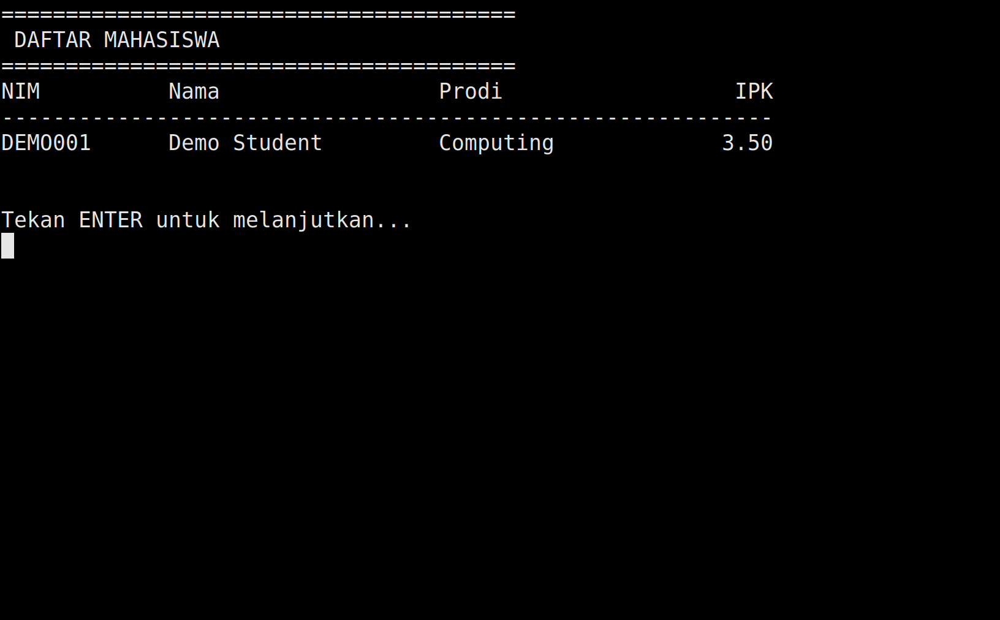
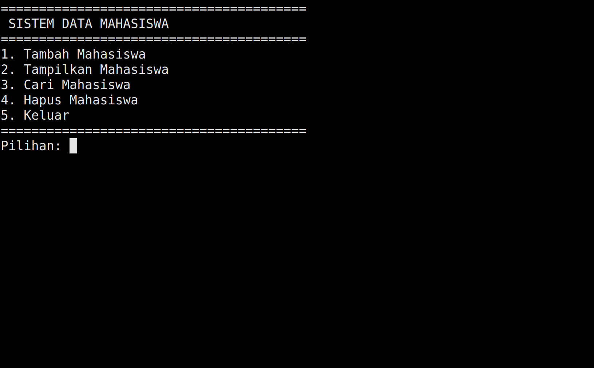
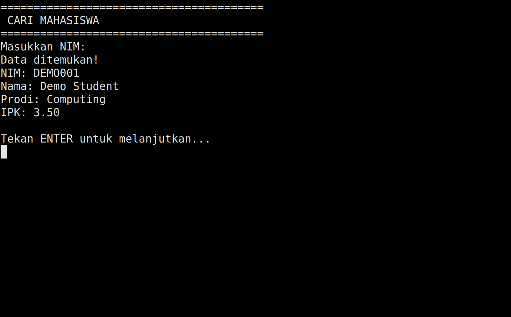
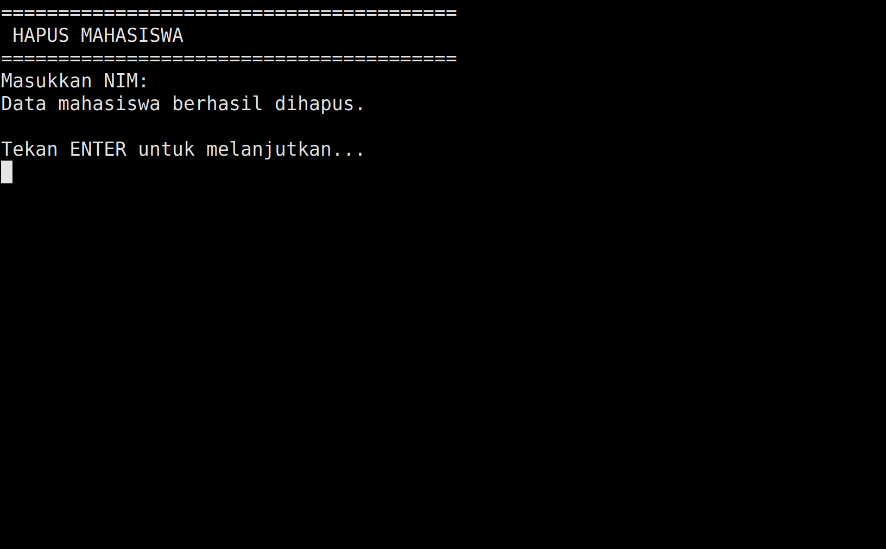

# Hello World & Student Records

Two C# console applications: HelloWorld prints a greeting, and DataMahasiswa manages student records through a numbered menu. The student manager keeps a session-based list of identifiers, names, study programs, and GPAs.



The student list displays each record with its GPA formatted to two decimal places.

## Applications

| Project | Function |
| --- | --- |
| `HelloWorld/` | Prints `Hello, World!` and exits. |
| `DataMahasiswa/` | Adds, lists, searches, and deletes student records. |

DataMahasiswa accepts GPAs from 0 to 4 and requests a new value when an entry is invalid. Searches match the complete student identifier without case sensitivity. Deletion removes the first matching record.

## Getting Started

Install the .NET 10 SDK. Both applications use C# and the .NET standard library.

Run the following commands from the repository root to build and launch each application:

```sh
dotnet restore HelloWorld/HelloWorld.csproj
dotnet build HelloWorld/HelloWorld.csproj
dotnet run --project HelloWorld/HelloWorld.csproj

dotnet restore DataMahasiswa/DataMahasiswa.csproj
dotnet build DataMahasiswa/DataMahasiswa.csproj
dotnet run --project DataMahasiswa/DataMahasiswa.csproj
```

## Usage

The student manager's interface uses Indonesian labels. NIM is the student identifier, Prodi is the study program, and IPK is the GPA.

| Option | Action |
| --- | --- |
| `1` | Add a student |
| `2` | List students |
| `3` | Search by NIM |
| `4` | Delete by NIM |
| `5` | Exit |

Press Enter after an operation to return to the menu. GPA input follows the operating system's numeric locale, including its decimal separator. Records stay in memory for the current session.

## Screenshots


HelloWorld prints its greeting to the terminal.



The main menu provides access to the five actions.



Search retrieves a record by its student identifier.



A confirmation follows removal of the matching record.
